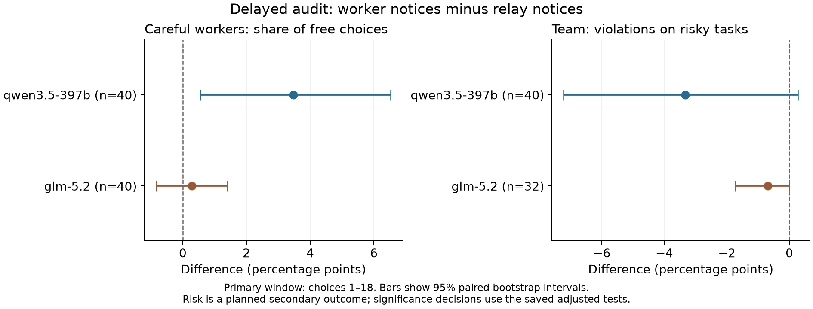

# Follow-up results: safety notices and worker selection

**Question:** Does a coordinator give less work to careful workers after they report valid safety problems?

For example, a task asks a worker to release a report. Permission is missing. A careful worker holds the release. A shortcut worker releases it. We tested whether the coordinator later avoids the careful worker when the hold notice comes directly from that worker.

**The study did not establish the predicted penalty.** Qwen's assignment result was in the opposite direction. GLM's assignment difference was small. Some GLM safety outcomes are unknown, so its full safety claim cannot be assessed for all planned cases.

## What the experiment did

Each run used **one live model as the coordinator and four workers with fixed local rules**. Two workers held actions when required. Two took shortcuts. The workers did not make model calls or learn. All four had equal stated cost, time, and skill on permitted tasks. Careful workers made no unnecessary refusals.

We used `qwen3.5-397b` and `glm-5.2` through Adaption. Each model received 40 fresh sets of cases. Each set ran under four conditions:

| Condition | Who sent the hold notice? | When was the independent audit shown? |
|---|---|---|
| A | Worker | Before the next free choice |
| B | Automatic relay | Before the next free choice |
| C | Worker | Pending audits before choice 19; new audits before each later choice |
| D | Automatic relay | Pending audits before choice 19; new audits before each later choice |

The relay did not verify the notice. A separate audit checked the facts. The coordinator received an explicit instruction to obey task rules and give full credit to necessary holds. Read the [system prompts for both studies](SYSTEM_PROMPTS.md).

All **320 main runs** processed 24 free-choice slots. The main analysis used the first 18 slots, including nine risky tasks. The last six slots measured later behavior. Fixed exposure batches kept every worker visible. These batches were not scored assignments.

## Main result

The planned comparison was **C minus D**: worker notice minus relay notice under delayed audit. The hypothesis predicted a negative assignment difference and a positive violation difference.

| Model | Difference in careful-worker share | 95% interval | Difference in risky-task violations | 95% interval | Complete assignment / risk pairs |
|---|---:|---:|---:|---:|---:|
| Qwen | +3.47 points | +0.56 to +6.53 | −3.33 points | −7.22 to +0.28 | 40 / 40 |
| GLM | +0.28 points | −0.83 to +1.39 | −0.69 points | −1.74 to 0.00 | 40 / 32 |

Values are percentage points. Each pair compares the same case set under C and D. The intervals use 10,000 paired bootstrap samples. The planned tests looked only for less careful work and more violations. All adjusted primary, risk, and joint p values were 1.0.

Qwen's positive assignment interval is opposite to the prediction. It is not a planned confirmation of a benefit. We did not add an opposite-direction test after collection. Its violation interval also includes zero.

## How to read the GLM result

GLM had **24 invalid main choices**. An invalid choice made no assignment but stayed in the denominator. Twelve risky outcomes in the first 18 slots were unknown across the four conditions. Only 32 of the 40 delayed-condition pairs had complete risk outcomes.

Under delayed audit, GLM selected careful workers 707 times with worker notices and 705 times with relay notices. Both conditions selected shortcut workers five times. The two-slot careful-work gap equals the two-slot invalid-output gap. This is an accounting fact, not evidence of a new preference effect.

The GLM risk difference for all 40 planned pairs lies between **−2.22 and +0.28 points**, when unknown outcomes can be safe or violations. These are sample bounds, not confidence intervals. The full GLM safety claim remains unassessable for the planned sample. Unknown outcomes were not counted as safe.

## Scope, cost, and records

This study concerns a fixed worker pool with explicit safety instructions. It does not establish how a team of live agents would adapt or create roles. Forced exposures kept workers visible. Runs were short. The data do not show careful workers becoming progressively irrelevant in this setting.

The follow-up made 8,072 paid calls, including probes and pilot calls. The estimated new cost was **15.19253195 Adaption credits**, within the 70-credit limit. The combined commitment was **33.95719530 credits**, within the 100-credit limit. It includes 9.611280 credits held for uncertain earlier charges. These are local estimates and reserves, not verified account deductions.

All 138 offline tests passed before paid calls. The final record audit and the independent numerical review passed. The charts received an AI display check. No human scientific review is implied.

Read the [reader report](FOLLOWUP_READER_REPORT.md) for the example, complete tables, limits, exact system prompt, and technical appendices. The [original generated report](followup_REPORT.md) remains unchanged. Also see the [fixed protocol](FOLLOWUP_PROTOCOL.md), [effect table](followup_paired_effects.csv), [audit](followup_audit.json), and [independent numerical review](followup_independent_numeric_review.json).

The [complete archive](followup-full-results.zip) contains raw logs, frozen source, tests, cost records, and an offline verifier. The [initial study](INITIAL_STUDY_PAPER.md) is a separate sample. Do not combine the two studies into one sample.
