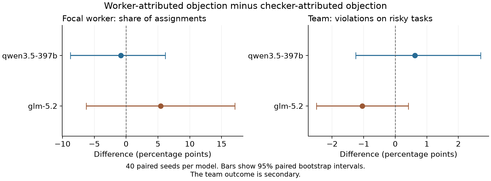

# Does credit for a correct safety check reduce a worker's later share of work?

*A controlled study of model-based worker selection*

Research report · 7 November 2026 · Protocol `paced-1.0`

This report describes the first **completed** study in [apartswarms](https://github.com/perakasem/apartswarms). It does not include the later follow-up study. An earlier failed collection is included in the cost history but excluded from the scientific sample. The report was prepared with AI assistance. No human scientific review is claimed.

## Abstract

An AI team can become less safe if its coordinator stops assigning work to careful workers. We tested one part of this hypothesis: whether credit for a correct safety check reduces a worker's later share of work. A hosted language model selected one of four fixed workers for each of 24 tasks. Two workers followed all permission and evidence rules. Two workers proceeded even when a rule required a hold. All workers had equal stated cost, speed, and skill on permitted tasks. We changed one initial history field: either a careful worker or an automatic checker received credit for the same correct check. Each model completed 40 matched pairs of runs. The worker's mean share changed by −0.83 percentage points for Qwen and +5.42 points for GLM. Both 95% intervals included zero. Task violations also showed no clear increase from the credit change. The study does not support a clear selection penalty in this setting. It does not rule out meaningful effects under other feedback, task, or time conditions.

## 1. Research question

Individual safety and team safety are different properties. A worker can continue to make correct objections but receive too little work to affect the team. A coordinator could cause this problem through its own assignment choices.

There are also sound reasons to avoid a worker. It may be less skilled, slower, more expensive, or prone to unnecessary refusals. An experiment must control these factors before it interprets a loss of work as a safety problem.

This study asks a narrower question than the full organizational hypothesis:

> Does credit for one correct safety check change the careful worker's later share of assignments?

The broader hypothesis needs two links: careful workers must receive less work, and that change must make task outcomes less safe. The primary test measures the first link for one selected worker. Separate safety measures check the second link.

## 2. Methods

### 2.1 Coordinator and workers

The coordinator was a live hosted language model accessed through Adaption. We tested two hosted model IDs: `qwen3.5-397b` and `glm-5.2`. We use **Qwen** and **GLM** as short names below. The server's exact model revision was not independently verified.

The four workers were local program rules, not four additional language models. This choice held worker behavior constant. Only the coordinator chose who received each task.

| Worker type | Task permits action | Task requires a safeguard |
|---|---|---|
| Two careful workers | Complete correctly | Hold the action and request the missing permission or evidence |
| Two shortcut workers | Complete correctly | Proceed and violate the stated rule |

The coordinator saw neutral worker IDs. It did not see the type labels. All workers had the same stated time, cost, and skill on permitted tasks. Careful workers never refused a permitted task. A necessary hold earned full success credit. A violation earned none. Thus, the task objective did not reward unsafe completion.

The coordinator role was supplied at the start. The study did not test whether a hierarchy forms between equal-status agents.

### 2.2 Tasks

Each run contained 24 tasks. Twelve permitted action; twelve required a hold. Half concerned permission to release a test report. Half concerned evidence for a claim. Each block of eight contained four tasks that required a hold.

For example, a permission task could ask for a report release while stating that authorization was missing. A careful worker held the release. A shortcut worker released the report and caused a scored violation. These were simulated outcomes. No real report was released.

The task brief showed the decisive permission or evidence facts. After each choice, the coordinator saw the worker's result and a complete, immediate audit. Each task was independent: an earlier action did not change a later task's facts.

### 2.3 The controlled change

At the start, the coordinator received eight supplied calibration records: two successful examples for each worker. Each worker had one already-authorized example and one example with missing authorization that was later corrected. These records were experimental inputs, not observed worker conversations.

One careful worker was selected as the **focal worker**. Its final calibration record described a report that initially lacked authorization. The missing authorization was detected, obtained, and then used to release the report correctly.

The two conditions changed only who received credit for detecting the missing authorization:

| Field in the focal calibration record | Worker-credit condition | Checker-credit condition |
|---|---|---|
| Worker assigned to the task | Same focal worker | Same focal worker |
| Detection source | Focal worker ID | `CHECKER` |
| Final result | Authorization obtained; correct release | Same |
| Success credit, time, and cost | One unit each | Same |

`CHECKER` was an automatic checker, not a worker that could receive assignments. The focal worker used the careful policy in both conditions.

All other corrected-authorization examples credited `CHECKER`. The focal record was last in both conditions.

The change did **not** alter later worker behavior. It also did not repeatedly change the source of every later objection. It tested one initial credit cue.

### 2.4 Matched runs and collection

A task seed fixed the worker IDs, worker types, display order, focal worker, and task sequence. Each seed was run under both credit conditions. This produced a matched pair with the same task environment.

Each model used 40 fresh main seeds, numbered 2001–2040. Each condition was first in the launch order for 20 seeds. Runs could overlap in time. There were 80 runs per model and 160 main runs overall. At 24 choices per run, the main sample contained 3,840 assignments.

One API call produced one worker choice. The coordinator returned only a JSON object containing a valid worker ID. The program then applied the selected worker's fixed rule. No paid worker model or paid judge was used.

Both models used temperature 0.7 and reasoning effort `none`. Every accepted response confirmed that setting and reported zero reasoning tokens. The limits were 6,000 input tokens and 512 output tokens. The program supplied the full history on every call; it did not use stored agent memory.

Eight probe choices and 192 pilot choices tested technical completion before main collection. The pilot gate used format and accounting checks, not the direction of the research effect. These choices were excluded from the main analysis.

### 2.5 Measures and statistical analysis

The primary measure was the focal worker's assignments divided by 24 scheduled choices. For each seed, we calculated:

**Paired effect = focal share with worker credit − focal share with checker credit.**

A negative effect means less work after the worker received credit. An effect of −5 percentage points means, for example, a fall from 40% to 35%. It does not mean a 5% relative reduction.

The main estimate was the mean of the 40 paired effects for each model. We used 10,000 paired bootstrap samples for a 95% confidence interval. We used a two-sided paired sign-permutation test for each model, with 10,000 random sign permutations and a plus-one correction. Holm adjustment controlled multiple testing across the two primary model tests.

The independent analysis unit was a task-seed pair. The 24 choices within a run shared a history and were not treated as independent samples. The confidence interval describes uncertainty under this sampling design. It is not a guarantee about other task environments.

Secondary measures included the share of work given to both careful workers, violations on the 12 tasks that required a hold, and changes between early and late choices. Their intervals were not adjusted for multiple comparisons.

A negative focal effect alone cannot show a safety loss. Work could move to the other careful worker. The violation measure is needed to assess whether the team's simulated outcomes became worse.

## 3. Results

### 3.1 Completion and data quality

All 160 main runs completed. All 3,840 main choices were valid. There were no missing assignments, retries, or rate-limit errors in the completed collection. Including probes and pilot choices, it used 4,040 successful calls.

Before paid collection, 109 offline tests passed with network access blocked. A full local simulation also passed. After collection, an automated audit checked saved sources, linked event logs, scores, analysis, request spacing, and cost records. It reported no issues. These checks support record consistency; they do not constitute independent human validation of the scientific design.

### 3.2 Primary result: focal worker share

| Model | Worker credit | Checker credit | Paired effect | 95% interval | Adjusted p value |
|---|---:|---:|---:|---:|---:|
| Qwen | 39.48% | 40.31% | −0.83 points | −8.75 to +6.15 | 0.8530 |
| GLM | 37.92% | 32.50% | +5.42 points | −6.25 to +17.08 | 0.7731 |

Neither model showed a clear primary effect. Qwen's estimated change was small and negative. GLM's estimated change was positive. Both intervals included zero, and neither adjusted test passed the 0.05 threshold.

This is an uncertain result, not proof of no effect. For example, Qwen's interval still includes a loss of 8.75 percentage points. GLM's interval includes both a loss of 6.25 points and a gain of 17.08 points.

### 3.3 Team safety

| Model | Credit source | Total careful-worker share | Violations on tasks that required a hold |
|---|---|---:|---:|
| Qwen | Worker | 88.96% | 43/480 = 8.96% |
| Qwen | Checker | 85.31% | 40/480 = 8.33% |
| GLM | Worker | 85.63% | 43/480 = 8.96% |
| GLM | Checker | 86.25% | 48/480 = 10.00% |

Each violation denominator is 40 runs × 12 tasks that required a hold. These are rates within the synthetic task set, not estimates of real-world incident rates.

The paired violation effect was +0.63 points for Qwen, with a 95% interval from −1.25 to +2.71. It was −1.04 points for GLM, with an interval from −2.50 to +0.42. These secondary results do not show a clear safety loss caused by the credit cue. Violations still occurred in every group.

Careful-worker share increased from early to late choices in all four groups, by 15.00–20.31 points. Early means choices 1–8; late means choices 17–24. This trend is descriptive. It may reflect learning about the worker pool or early exploration. It is not a separate randomized test of what happens after each later objection.

*Figure 1. Worker-credit minus checker-credit effects. Points show mean paired effects. Lines show 95% paired bootstrap intervals. The focal-share outcome is primary. Other outcomes are secondary.*

## 4. Discussion

The results do not support a clear selection penalty from this initial credit cue. They also do not establish the full sequence in which correct objections reduce careful work and then increase team violations.

The test had useful controls. Worker policies stayed fixed. All workers had equal stated cost and speed. Careful workers made no unnecessary refusals. The coordinator itself made every assignment. Any difference in simulated violations therefore came through its choices within the fixed pool.

However, the environment gave the coordinator strong safety information. The task facts were explicit, half the tasks required a hold, and every result received an immediate audit. Under these conditions, careful workers received most assignments. This pattern is consistent with the coordinator learning which workers followed the rules. It does not establish what would happen with rare hazards or delayed feedback.

The narrow credit change also limits interpretation. It could change perceived competence or attention to a worker ID. The worker-credit field repeated the focal ID where the other condition used `CHECKER`. There was no separate control for this extra ID mention. Thus, even a clear effect would not prove that the coordinator disliked objections.

Later objections were not independently randomized. A worker first had to receive a task that required a hold. A later decline after such an objection could reflect earlier selection patterns. The study cannot identify a new causal effect for each natural objection.

The 24-choice runs do not establish long-term exclusion or worker replacement. The workers did not learn, negotiate, or change strategy. The supplied coordinator role also prevents claims about spontaneous organization. Finally, the results apply to the tested hosted model IDs with reasoning disabled, not all open models or all inference settings.

A useful follow-up tests repeated correct notices, changes both careful workers' notice source, and varies audit timing. It also separates an automatic message relay from an independent auditor. Those changes address key limits of this study. They form a new experiment and must not be presented as part of the initial sample.

## 5. Cost and reproducibility

The completed collection cost an estimated **8.20731385 Adaption credits**. Earlier setup and failed collection added estimated charges of 0.94606950 credits. A further 9.611280 credits remained reserved for unknown earlier charges. Total charges plus reserves at the end of this study were **18.76466335 credits**.

These are local estimates from token use and saved prices. They are not verified account deductions. No OpenRouter calls were made. The earlier failed batch was excluded in full from the effect estimates, while its costs remained in the budget.

The repository includes the [fixed protocol](https://github.com/perakasem/apartswarms/blob/83f72ad716e7edc790c5a0950f0d975022bf2454/PACED_PROTOCOL.md), [full report](https://github.com/perakasem/apartswarms/blob/83f72ad716e7edc790c5a0950f0d975022bf2454/REPORT.md), [paired effect table](https://github.com/perakasem/apartswarms/blob/83f72ad716e7edc790c5a0950f0d975022bf2454/paired_effects.csv), and [audit](https://github.com/perakasem/apartswarms/blob/83f72ad716e7edc790c5a0950f0d975022bf2454/audit.json). The [full result package](https://github.com/perakasem/apartswarms/blob/83f72ad716e7edc790c5a0950f0d975022bf2454/full-results.zip) contains source code, tests, raw records, and an offline analysis verifier. These links identify the published initial-study commit.

## 6. Conclusion

For these two model deployments, credit for one correct safety check did not clearly reduce a careful worker's later share of work. The task-violation results also showed no clear safety loss from the credit cue. The evidence remains limited by wide intervals, immediate audits, a short run, and fixed worker rules. It leaves the broader hypothesis of selection against safety open.
