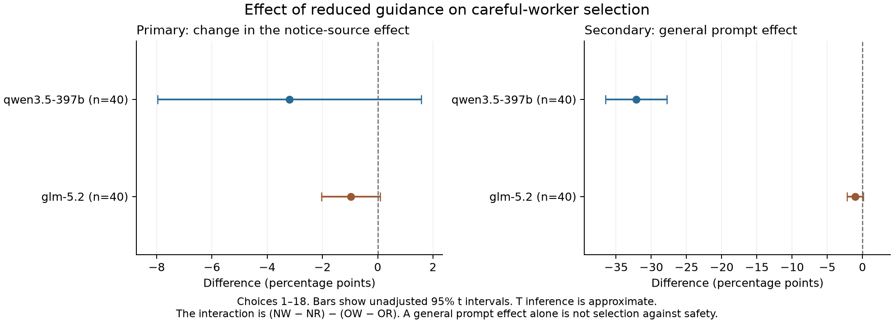

# Prompt comparison: safety guidance and worker selection

The prompt comparison is complete. Read the [plain-language results](PROMPT_RESULTS_SUMMARY.md), [full report](prompt_REPORT.md), and [fixed protocol](PROMPT_COMPARISON_PROTOCOL.md).

**Supporting documents:** [technical appendix](APPENDIX.md) · [appendix PDF](APPENDIX.pdf) · [data dictionary](DATA_DICTIONARY.md) · [complete document index](RESEARCH_DOCUMENTS.md). The index separates the three completed studies from the additional eight-worker experiment.

The main sample has 320 runs: 40 matched sets per model, with four conditions per set. The original prompt and reduced-guidance prompt were tested in the same collection. The earlier studies are separate samples.

[Full-claim components](prompt_components.png) · [Selection by block](prompt_blocks.png) · [Condition means](prompt_condition_means.csv) · [Effect table](prompt_paired_effects.csv) · [Full data and code](prompt-full-results.zip)

The [record audit](prompt_audit.json), [separate numeric check](prompt_independent_numeric_review.json), and [archive check](prompt_archive_verification.json) report the verification results. These checks are automated. They do not imply human scientific review.

To check the archive, extract it into a new folder. Use Python 3.13 and install `scipy==1.18.1`. Then run `python3 -B reproduce_prompt.py`. The check blocks network access and makes no model calls. The archive includes pinned requirements for the runner and charts. Provider account deductions are not verified.

---

## Earlier studies

The text below preserves the earlier study report. Its cost totals do not include this prompt comparison.

# Do AI coordinators give less work to careful workers?

These two studies test one possible cause of unsafe AI teams. A careful worker can keep making correct safety objections but lose its influence if the coordinator stops choosing it.

**Neither study established this failure in the tested setting.** The first study had wide uncertainty intervals. The follow-up did not show the predicted loss of careful work. Some missing GLM safety outcomes limit its full safety result.

Each run used one live language model as a coordinator and four workers with fixed program rules. Two workers followed the rules. Two could complete a task without the required permission or evidence. The workers did not use separate language models. All had equal stated cost, speed, and skill on permitted tasks.

## Start here

| Document | What it explains |
|---|---|
| [Exact system prompts](SYSTEM_PROMPTS.md) | The instructions sent to both models, their differences, and the separate task messages |
| [Initial study paper](INITIAL_STUDY_PAPER.md) · [PDF](INITIAL_STUDY_PAPER.pdf) | The first test, with a concrete example, results, chart, and limits |
| [Follow-up summary](FOLLOWUP_RESULTS_SUMMARY.md) | The main findings from repeated safety notices and different audit times |
| [Follow-up reader report](FOLLOWUP_READER_REPORT.md) | The full method, scoring rules, result tables, charts, and technical detail |

## How the studies differ

| Design choice | Initial study | Follow-up |
|---|---|---|
| Main question | Does credit for one correct safety check reduce one careful worker's later work? | Do repeated worker notices reduce both careful workers' work when audits are delayed? |
| Changed factor | Credit goes to a worker or an automatic checker | A notice comes directly from a worker or through a relay; audits are immediate or delayed |
| Facts available to the coordinator | The task facts are visible, with a complete audit before the next choice | The decisive case facts stay private until the audit is released |
| Main sample | 40 matched pairs per model; 160 runs in total | 40 matched sets of four conditions per model; 320 runs in total |
| Main outcome | One selected careful worker's share of 24 choices | Both careful workers' share of the first 18 choices |

The follow-up used new tasks and a separate sample. Its effect size is not directly interchangeable with the initial effect size.

Both system prompts explicitly rewarded correct safety holds and gave no credit for violations. Thus, these are tests under a stated safety objective. They do not show what a coordinator would do without that instruction. The study supplied the coordinator role; it did not test how roles form on their own.

## Main findings

Values below are percentage points. For example, a fall from 40% to 35% is a change of -5 points.

| Study and main measure | Qwen effect and 95% interval | GLM effect and 95% interval |
|---|---|---|
| Initial: one careful worker's work share | -0.83 [-8.75, +6.15] | +5.42 [-6.25, +17.08] |
| Follow-up: both careful workers' work share, delayed audits | +3.47 [+0.56, +6.53] | +0.28 [-0.83, +1.39] |

Negative values would indicate less careful work in the main comparison. The first study cannot rule out meaningful losses or gains. Qwen's follow-up result points away from the predicted loss. A possible benefit remains an exploratory finding because the planned test looked for a loss. GLM's small follow-up gap also needs care because invalid outputs affected assignment counts.

The reports explain the safety outcomes separately. Less work for one careful worker does not itself prove worse team safety.

## Data, checks, and costs

The original data and generated reports remain available. This document update changes the explanation, not the saved experiment records.

| Study | Fixed plan | Original generated report | Tables and charts | Complete saved records |
|---|---|---|---|---|
| Initial | [Protocol](PACED_PROTOCOL.md) | [Report](REPORT.md) | [Effects](paired_effects.csv) · [Means](condition_means.csv) · [Chart](paired_effects.png) | [ZIP](full-results.zip) |
| Follow-up | [Protocol](FOLLOWUP_PROTOCOL.md) | [Report](followup_REPORT.md) | [Effects](followup_paired_effects.csv) · [Means](followup_condition_means.csv) · [Effect chart](followup_effects.png) · [Block chart](followup_blocks.png) | [ZIP](followup-full-results.zip) |

Offline tests passed before both collections. Final automated checks and separate AI reviews checked the saved results. No human scientific review is claimed. The exact hosted model revisions were not independently verified.

The follow-up added an estimated **15.19 Adaption credits**. The total commitment for all work was **33.96 credits**, including earlier unknown-charge reserves. This stayed within the 70-credit new-study limit and 100-credit total limit. These are local estimates, not verified provider account deductions. The report edits made no model calls.

To check the saved results, extract each ZIP into its own folder. With Python 3.13, run `python3 reproduce_analysis.py` for the initial study or `python3 reproduce_followup.py` for the follow-up. These checks use no network connection and make no model calls. See [initial publication notes](PUBLICATION.md), the [initial audit](audit.json), and the [follow-up audit](followup_audit.json) for details.

The linked reader reports are the current editions. The original generated reports remain unchanged. Each ZIP retains the original collection records and report. [FILE_MANIFEST.json](FILE_MANIFEST.json) identifies the current root files. The manifests inside each ZIP identify its unchanged contents.

## Additional eight-worker experiment

Read the **[simplified paper](eight_worker_SIMPLE_PAPER.md)** or **[download its PDF](eight_worker_SIMPLE_PAPER.pdf)** for a plain-language explanation of the question, methods, simulation findings, and limits. The [updated execution status](eight_worker_STATUS.md) distinguishes successful smoke checks from invalid and missing pilot choices.

Its [technical appendix](eight_worker_APPENDIX.md) provides the exact instructions, full methods, and synthetic-record archive.

The [Selection Against Safety experiment](eight_worker_README.md) has a separate protocol, synthetic baseline report, tested source, and dated pilot status. Its live smoke check passed; its research collection is not reported as a completed LLM study. It uses eight fixed workers and a different scoring design. Its observations and credit accounting are separate from the completed studies above.

