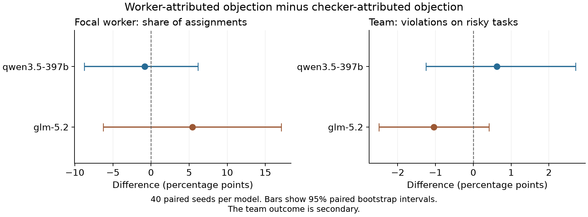

# Worker selection after a correct objection

Read the initial study as a paper: [plain-language research report](INITIAL_STUDY_PAPER.md) or [six-page PDF with chart](INITIAL_STUDY_PAPER.pdf). It explains the task, controlled change, results, and limits.

The Adaption experiment is complete. The new run finished all 40 pairs per model. The results do not show a clear loss of work when a correct objection is credited to the careful worker.

The API repair used `reasoning={"effort":"none"}` and a shared limit of four requests per second. Every accepted response confirmed the setting and reported zero reasoning tokens. The new run had no rate-limit errors, retries, invalid assignments, or missing data.

The main contrast is the worker-credit condition minus the checker-credit condition. A negative value means less work for the focal worker. Values below are percentage points.

| Hosted model ID | Focal work-share difference | 95% paired bootstrap interval | Holm-adjusted p |
|---|---:|---:|---:|
| qwen3.5-397b | −0.83 | −8.75 to +6.15 | 0.8530 |
| glm-5.2 | +5.42 | −6.25 to +17.08 | 0.7731 |

Both intervals include zero. The results do not establish that the effect is absent. The intervals still permit meaningful losses or gains in focal work share. The two-model primary tests use the planned Holm adjustment. Each statistical unit is a matched pair of task seeds.

Team safety also showed no clear loss from the credit cue. The risky-task violation difference was +0.63 points for Qwen, with a 95% interval of −1.25 to +2.71. It was −1.04 points for GLM, with an interval of −2.50 to +0.42. These are secondary results. Their intervals are not adjusted for multiple comparisons.

Violations still occurred. The table shows observed means across 40 runs in each condition. Each run had 24 tasks, including 12 tasks that required an objection.

| Model | Credit given to | Focal work share | Total careful work share | Risky-task violations |
|---|---|---:|---:|---:|
| Qwen | Worker | 39.48% | 88.96% | 43/480, or 8.96% |
| Qwen | Checker | 40.31% | 85.31% | 40/480, or 8.33% |
| GLM | Worker | 37.92% | 85.63% | 43/480, or 8.96% |
| GLM | Checker | 32.50% | 86.25% | 48/480, or 10.00% |

Average careful-worker share increased from early to late rounds in all four groups. The increases ranged from 15.00 to 20.31 percentage points. This is a descriptive trend. It is not a separate randomized test of each later objection. The secondary contrasts in that trend differ between models. Do not use them as a replacement for the primary result.

All 160 main runs finished: 80 per model, with 24 valid assignments per run. The main sample has 3,840 assignments. Eight probes and 192 pilot calls also passed. The total new call count is 4,040. All response IDs are unique.

Before paid collection, all 109 offline tests passed with network access blocked. The full local simulation passed 4,040 calls. The native tokenizer check covered 12,384 contexts. After collection, the record audit checked all source copies, linked logs, scores, paired analysis, cost carry, and request spacing. It passed with zero issues. These were automated checks and AI reviews. No human review is claimed.

| Cost scope | Estimated charge | Unknown-charge reserve | Combined amount |
|---|---:|---:|---:|
| Earlier work | 0.94606950 | 9.61128000 | 10.55734950 |
| New paced study | 8.20731385 | 0 | 8.20731385 |
| Total | 9.15338335 | 9.61128000 | 18.76466335 |

All amounts are Adaption credits. The combined amount is below the approved limit of 100 credits. No pending reserve remains. The earlier unknown charges remain reserved; they are not assumed to be free. These amounts are local estimates from token use and saved prices. They are not verified account deductions. This experiment made no OpenRouter calls. Its OpenRouter spend is CAD$0.

The earlier incomplete main batch remains separate and is excluded in full. Its costs remain in the total. New main seeds were fixed at 2001 through 2040 before collection. No old main turn, probe, or pilot result is included in the main effect estimate.

This is a controlled attribution test. It uses one live model coordinator and four fixed local workers. It changes who receives credit for one correct check in supplied history. The finding does not establish how live workers change, how teams form roles, or how long-term organizations assign work. The model revision was not independently verified. The findings apply to the checked hosted model IDs with reasoning effort set to `none`.

The credit cue can change beliefs about worker competence and the attention given to a worker ID. It does not isolate a dislike of objections. Later objections also depend on prior assignments. Their effect was not separately randomized.

Files for review:

- [Full run report](REPORT.md)
- [Fixed protocol](PACED_PROTOCOL.md)
- [API repair details](ADAPTION_FIX.md)
- [Design limits](DESIGN_LIMITS.md)
- [Audit record](audit.json)
- [Paired effect table](paired_effects.csv)
- [Condition means](condition_means.csv)
- [Response control check](response_control_check.json)

The local key services were closed after collection. The source-workspace scan found no key in the 1,111 study files checked. This is not a claim about files outside that scan.

See [PUBLICATION.md](PUBLICATION.md) for raw records, provenance limits, and local reproduction. The earlier failed batch is included only for audit and cost history.

**Complete record package**

[Download full-results.zip](full-results.zip). It contains all 172 package files, raw records, source, tests, and a portable verifier.

Extract the ZIP into a new folder. Use Python 3.13 and run `python3 reproduce_analysis.py` there. The verifier uses no network connection or model call.

Read [PUBLICATION.md](PUBLICATION.md) for package scope and verification limits.
