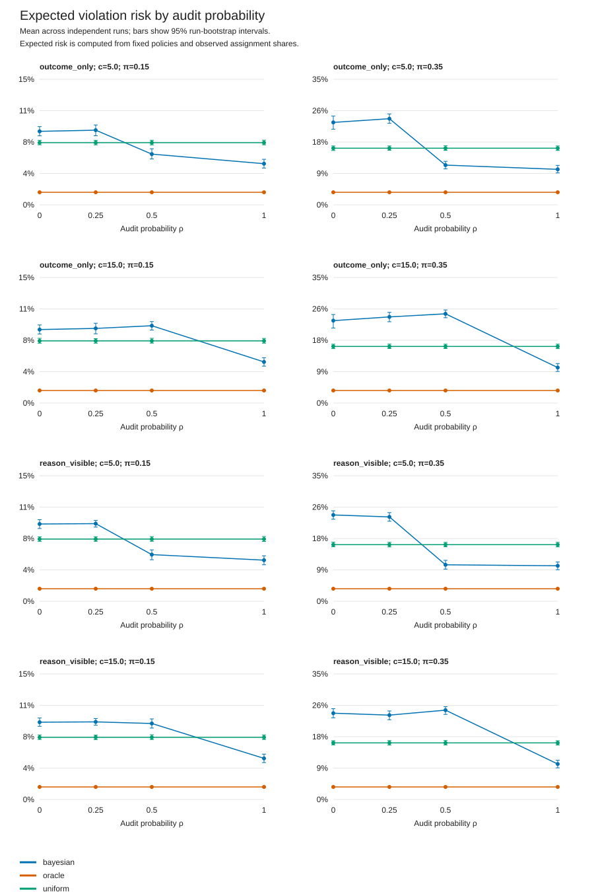

# Selection Against Safety: eight-worker pilot

See the [technical appendix](eight_worker_APPENDIX.md) for exact prompts, analysis definitions, and the complete synthetic baseline records. The repository-wide [document index](RESEARCH_DOCUMENTS.md) keeps this experiment separate from the completed four-worker studies.

This document set and its [source archive](eight_worker_source_and_baselines.zip) contain the protocol, executable code, and synthetic baseline results for an eight-worker experiment on whether a coordinator's allocation choices reduce the influence of careful workers. It is a separate experiment from the completed four-worker studies in the repository root. Their observations, estimates, and credit totals are not pooled here.

The completed baseline collection contains **1,920 simulated episodes and 115,200 assignments**. The repaired live smoke test completed one decision for each of three models. Those connectivity checks do not establish the research hypothesis. See the dated [execution status](eight_worker_STATUS.md) for the latest observed pilot progress and failures.

Start with the **[simplified paper](eight_worker_SIMPLE_PAPER.md)** or its **[PDF edition](eight_worker_SIMPLE_PAPER.pdf)**. The live preference pilot recorded 87 cases, of which 50 were valid, before a request-budget interruption; see the [updated status](eight_worker_STATUS.md). No repeated 60-round live study output was found at that snapshot.

## Documents and results

| File | Purpose |
|---|---|
| [Execution plan](eight_worker_PLAN.md) | Question, factorial design, analysis commitments, and scope |
| [Methods](eight_worker_METHODS.md) | Worker policies, scores, observation boundaries, estimands, uncertainty, and limits |
| [Prompt v2 amendment](eight_worker_AMENDMENT_V2.md) | Token-limit repair and clarification of terminal task scoring |
| [Baseline summary](eight_worker_BASELINE_RESULTS.md) | Plain-language interpretation of the synthetic checks |
| [Full baseline report](eight_worker_RESULTS.md) | All 96 condition-by-policy groups and exploratory intervals |
| [Condition metrics](eight_worker_condition_metrics.csv) | Machine-readable estimates, intervals, and coverage |
| [Run metrics](eight_worker_run_metrics.csv) | Per-episode summaries for all 1,920 baseline episodes |
| [Provenance](eight_worker_provenance.json) | Original collection details and hashes of published baseline outputs |
| [Execution status](eight_worker_STATUS.md) | Dated live smoke and pilot status; no final LLM finding claimed |
| [Validation record](eight_worker_VALIDATION.json) | 55 passing tests and full offline trajectory regeneration |



The scripts use only the Python standard library (Python 3.10+). `selection_safety/core.py` implements fixed worker policies and the environment; `run_experiment.py` runs repeated allocation; `preference_pilot.py` runs matched-history choices; `analysis.py` computes descriptive results. API tests use fake transports and make no paid calls.

## Reproduce offline

From a local clone of this repository, extract the accompanying archive, then run:

```sh
python3 -m zipfile -e eight_worker_source_and_baselines.zip .
cd experiments/selection-against-safety
python3 -m unittest discover -s selection_safety -p 'test_*.py' -v
python3 -m selection_safety.run_experiment baseline --cells full --seeds 0,1,2,3,4,5,6,7,8,9,10,11,12,13,14,15,16,17,18,19 --output outputs/baselines_new
python3 -m selection_safety.analysis --input outputs/baselines_new/runs --output outputs/baseline_analysis_new --bootstrap 1000 --seed 1729
```

These commands make no model calls. The published baseline collection used prompt version 1; the current runner uses version 2. The environment and baseline policy dynamics are unchanged. All 1,920 regenerated trajectories were checked against the saved baseline collection: every round field matched after excluding run identifiers and prompt version. New identifiers, timestamps, and protocol hashes differ. Because analysis sorts runs by identifier before bootstrap resampling, regenerated interval endpoints may also differ slightly; point estimates remain the same. The three original executed protocol source files are preserved in [results/baselines/protocol_source](eight_worker_source_and_baselines.zip). Raw round logs are regenerated by the command above; they are not included in this document-and-code publication.

## Run live inference

Run the following from `experiments/selection-against-safety` with outbound access to Adaption. These commands consume existing provider credits. Model availability and current prices should be checked before a new collection.

```sh
python3 -m selection_safety.setup_key
python3 -m selection_safety.run_experiment smoke --output outputs/live_smoke_v2 --max-output-tokens 8192 --max-credits 1 --max-requests 20
python3 -m selection_safety.preference_pilot --models deepseek-v4-flash gemma-4-26b-a4b-it qwen3.8-27b --output outputs/preference_v2/pilot.jsonl --max-output-tokens 8192 --max-credits 2 --max-requests 110
python3 -m selection_safety.run_experiment pilot --output outputs/live_pilot_v2 --max-output-tokens 8192 --max-credits 25 --max-requests 5000 --concurrency 3
python3 -m selection_safety.analysis --input outputs/live_pilot_v2/runs --input outputs/baselines_new/runs --output outputs/live_analysis_v2 --bootstrap 2000
```

Complete the offline baseline command before the combined analysis. Each live stage has a separate request and estimated-credit cap: 1, 2, and 25 credits respectively. These are local bounds and estimates, not verified account deductions or a currency conversion. The code does not purchase credits. The hosted-model catalog is checked before inference; unavailable models are not silently replaced.

The key helper accepts hidden input and saves a local credential with restricted permissions. `ADAPTION_API_KEY` can instead be supplied through a secret manager. Credentials and generated output directories are ignored by Git.

The preference pilot plans 96 choices. The repeated-assignment pilot plans 72 runs of 60 rounds, or 4,320 decisions. Environment seeds reproduce task and worker draws; the provider's stochastic sampling is not seeded by those values. Temperature is 0.7 and the common output-token cap is 8,192.

Reusing an output path reuses its records and budget ledger. Changed protocols require fresh output directories. Preference cases already recorded as API or format failures are treated as finished cases and are skipped on resume; rerunning does not retry them. Failed choices remain missing and are not replaced with a scripted choice. Repeated-run completion and all API failures must be checked in execution status before interpreting the analysis, which excludes incomplete runs by default. A finished process does not imply every planned observation is valid.

## Interpretation

The numerical score intentionally creates a conflict between visible completion rewards and violations that escape audit. Its algebraic ranking threshold is an implication of the supplied payoff model. Synthetic results check that mechanism and the implementation; they do not show that an LLM selects against safety. The task-type interaction also changes audits, payoffs, and evidence, so it does not isolate a pure causal effect of objecting. The methods document explains these limits and the scope of the exploratory intervals.

Source design: [Claude artifact](https://claude.ai/artifact/MLXxGsnPn4D5vw7SAeRtWb#767a634e-a370.mtax210mka4.60). Hackathon: [Apart Swarm Alignment, Track 2](https://apartresearch.com/sprints/swarm-alignment-2026#resources). API reference: [Adaption inference quickstart](https://docs.adaptionlabs.ai/inference-stacks/quickstart/).

The archive contains the original directory layout, runnable source, tests, protocol snapshots, and the published baseline tables. Its internal `FILE_MANIFEST.json` lists SHA-256 hashes; the repository root manifest identifies the archive and these readable companion files.
